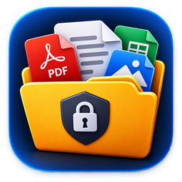

<p align="center"></p>

# Мої документи

Android-додаток для надійного зберігання особистих документів і документів на майно:
паспорти, ID, свідоцтва, документи на нерухомість і транспорт, фінансові, медичні,
страхові, освітні тощо. Усе зберігається **лише на телефоні** в зашифрованому вигляді.

## Можливості

- **Розділи**: Особисті, Нерухомість, Транспорт, Фінанси, Юридичні, Медичні, Страхування, Освіта, Інше.
- **Додавання**: фото з камери, кілька фото з галереї, будь-які файли (PDF, Word, Excel, зображення…).
- **Картка документа**: номер/серія, строк дії з попередженням за 60 днів, нотатки.
- **Вбудована читалка** (з проєкту doc_reader) — без сторонніх додатків:
  PDF, фото, DOCX (з форматуванням і картинками), DOC, RTF, XLSX, ODT, TXT/CSV/HTML.
  Масштабування щипком і подвійним дотиком, зміна розміру шрифту, 7 кольорів сторінки (нічна, сепія…).
- **Надсилання** в будь-який додаток: оригінали або **одразу одним PDF** з усіх файлів документа.
- **Друк** через системний сервіс Android (будь-який формат друкується як PDF).
- **Конвертація в PDF** будь-якого підтримуваного формату.
- **Резервні копії**: уся база або вибрані розділи в один ZIP із шифруванням **AES-256**.
  На Windows відкривається в 7-Zip / WinRAR / Bandizip лише після введення пароля
  (вбудований провідник Windows такі архіви не відкриває). Ту саму копію можна відновити
  на іншому телефоні в цьому ж додатку — теж лише з паролем автора копії.
- **Вхід на вибір**: біометрія або PIN пристрою, власний пароль додатку, або пароль + відбиток.
- **Теми**: темно-синя (за замовчуванням), синя, зелена, бордова, бурштинова, фіолетова,
  графітова, кольори шпалер (Android 12+); світлий, темний або системний режим.

## Безпека

| Що | Як |
|---|---|
| Файли | AES-256-GCM (Tink Streaming AEAD, сегменти 4 КБ), кожен файл прив'язаний до свого ідентифікатора |
| Список документів | AES-256-GCM, атомарний запис |
| Ключі | Обгорнуті головним ключем з Android Keystore (апаратне сховище), не експортуються |
| Пароль додатку | Лише хеш PBKDF2-HMAC-SHA256, 210 000 ітерацій; після 5 помилок — зростаюча пауза |
| Екран | Заборона скріншотів і запису, вміст прихований у списку останніх додатків |
| Резервне копіювання Android | Вимкнено (`allowBackup=false`) — копії лише власні, зашифровані |
| Мережа | Додаток не має дозволу на інтернет |
| Тимчасові файли | Розшифровані копії для надсилання/друку/перегляду видаляються при наступному розблокуванні та запуску |

Резервна копія: зовнішній ZIP зашифровано AES-256 (WinZip AES), усередині — один `Архів.zip`
з папками `Розділ/Документ/файли`, тож без пароля не видно навіть назв файлів.

> ⚠️ Якщо видалити додаток або скинути телефон, ключі з Keystore зникають разом із даними.
> Регулярно робіть зашифровану резервну копію.

## Як встановити

1. Відкрийте **Releases** цього репозиторію з телефона.
2. Завантажте `MyDocuments-N.apk` і відкрийте його.
3. Якщо Android попросить — дозвольте встановлення з цього джерела.

## Збірка

Потрібні JDK 17 і Android SDK:

```bash
./gradlew assembleRelease
```

GitHub Actions збирає APK на кожен push / PR. Ключ підпису береться із секретів репозиторію
`SIGNING_KEYSTORE_BASE64` (keystore у base64, alias `archive`) і `SIGNING_PASSWORD`.
Без них APK підписується тимчасовим ключем і не встановиться поверх попередньої версії.

Вимоги: Android 9 (API 28) і новіше.
